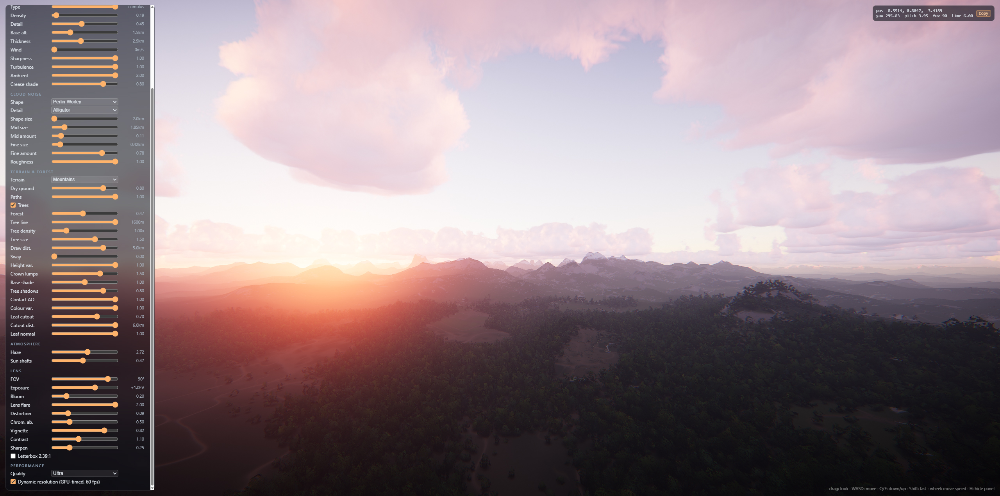
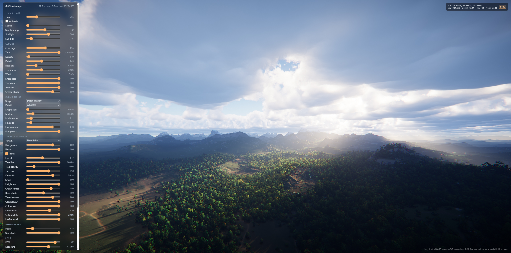

# Cloudscape

**A real-time volumetric sky you can fly through, right in your browser.**

Towering cumulus clouds, a physically based atmosphere, mountains and forests that catch the light, and sun shafts that pour through gaps in the clouds and over the ridges.
All of it is generated by code: no images, no 3D models, no libraries. The whole thing is **one ~100 KB HTML file**.

**[Launch the live demo](https://Fishypants.github.io/cloudscape/)**

## Try it

1. Open the [live demo](https://Fishypants.github.io/cloudscape/), or download [`index.html`](index.html) and open it in **Chrome**, **Edge** or **Firefox** on a desktop computer.
2. Wait a moment while the cloud noise is generated.
3. Drag with the mouse to look around, and fly with `W` `A` `S` `D`.

Nothing to install, and it works offline. It needs **WebGL2** with floating-point render targets (`EXT_color_buffer_float`), which any reasonably recent desktop GPU and browser supports. A dedicated graphics card is recommended.

## What's in the sky

- **Volumetric clouds** that you can fly into, from flat stratus to towering cumulus, with dark creases between billows and bright, sunlit rims
- **A physically based atmosphere**: blue skies, orange sunsets, haze, and a starry sky at night
- **Real volumetric sun shafts** cast by both the clouds and the mountains
- **Mountains or rolling hills**, with snow caps, rock, grass, dry patches and winding paths, and cloud shadows sweeping across the ground
- **Procedural forests**: thousands of individually shaped, swaying trees with their own shadows and contact shading
- **A full time-of-day cycle**: set the time, or let it animate from sunrise to sunset and into the night
- **Camera lens effects**: bloom, lens flare, lens distortion, chromatic aberration, vignette and an optional 2.39:1 cinema letterbox

| | |
|---|---|
|  |
|  |  |

## Controls

| | Keyboard & mouse |
|---|---|
| Look around | Drag with the mouse |
| Fly | `W` `A` `S` `D` (or the arrow keys) |
| Down / up | `Q` / `E` (or `Ctrl` / `Space`) |
| Fly faster | Hold `Shift` |
| Change flying speed | Mouse wheel |
| Hide / show the settings panel | `H` |
| Collapse the settings panel | Click its title bar |

## The settings panel

Every part of the scene can be changed live from the panel in the bottom-left corner. Drag a slider, or click a value and type a number (typed values can go beyond the slider range).

| Section | What you can change |
|---|---|
| **Time of day** | Time, sun heading, sunlight strength, sun disk size, and an animated day cycle |
| **Clouds** | Coverage, cloud type (stratus to cumulus), density, detail, base altitude, thickness, wind, sharpness, turbulence, ambient light, crease shading |
| **Cloud noise** | The noise used to build the cloud shapes (Perlin-Worley or Perlin-Alligator) and their detail (Alligator, Worley or Billow Perlin), plus size and strength of each noise layer |
| **Terrain & forest** | Mountains or rolling hills, dry ground and paths on the flat areas, forest coverage, tree line, tree density, size, draw distance, sway, crown lumps, tree shadow strength, colour variation and leaf cutout |
| **Atmosphere** | Haze and sun shaft strength |
| **Lens** | Field of view, exposure, bloom, lens flare, distortion, chromatic aberration, vignette, contrast, sharpening, letterbox |
| **Performance** | Quality level (Low, Medium, High, Ultra) and dynamic resolution |

## Performance

The clouds and atmosphere are raymarched at a lower resolution and then sharpened back up over several frames, so the expensive work stays manageable. With **dynamic resolution** switched on (the default), the page measures how long the GPU takes for each frame and lowers or raises that resolution in small steps to hold 60 fps. If your computer struggles, pick a lower **Quality** level in the Performance section.

<!-- Optional: add your own numbers here, e.g. "About 60 fps at 2560x1440 on Ultra on an RTX ____." -->

## How it works

- Everything is drawn with **WebGL2** directly. No game engine or 3D library is used.
- On startup, the page bakes the 3D cloud noise textures, the weather map and the foliage noise on the graphics card. Nothing is downloaded.
- **Atmosphere:** precomputed transmittance and multiple-scattering lookup tables, in the style of Hillaire (2020), "A Scalable and Production Ready Sky and Atmosphere Rendering Technique".
- **Clouds:** raymarched through a 3D noise volume, after Schneider's work on Horizon Zero Dawn ("The Real-time Volumetric Cloudscapes of Horizon: Zero Dawn", 2015, and "Nubis", 2017).
- **Terrain:** an eroded fractal noise heightfield on a curved planet, lit with three cascaded shadow maps.
- **Trees:** one instanced draw call. Each tree's position, shape, colour, size and lumpy crown are worked out in the vertex shader, so there is no tree data stored anywhere. The same shader draws the trees into the two nearest shadow cascades, so their shadows match the crowns, holes in the leaves included.
- **Image quality:** temporal accumulation with reprojection, a depth-aware upsample of the low-resolution volumetrics, then bloom, ACES tone mapping and the lens effects.

Units in the code are kilometres. The JavaScript and all the GLSL shaders are in `index.html`, with comments throughout. To experiment, open it in a text editor, change something and reload the page.

## License

[MIT](LICENSE): free to use, change and share, including in your own projects.
